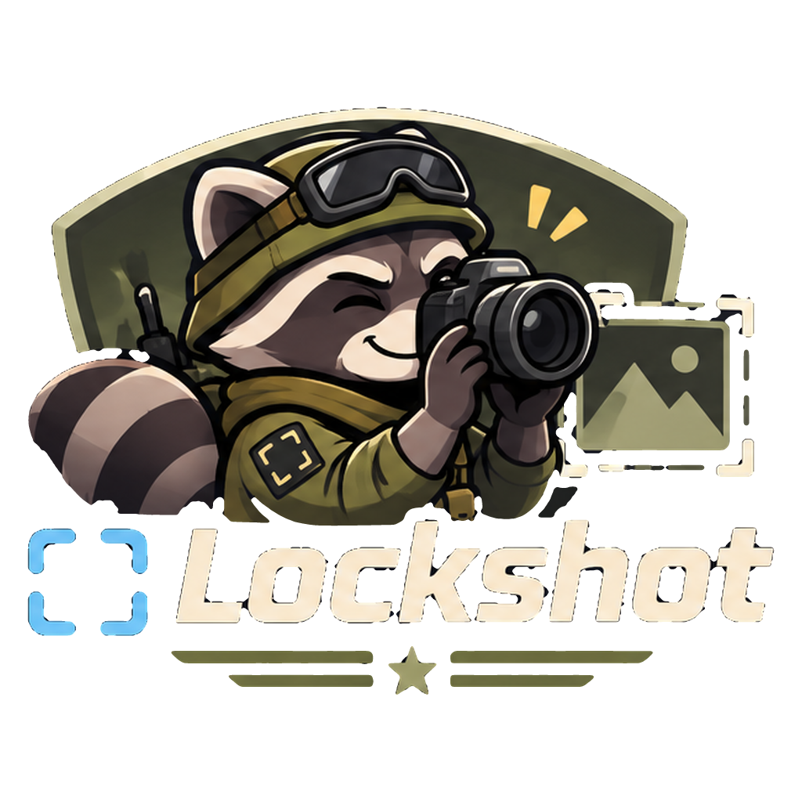
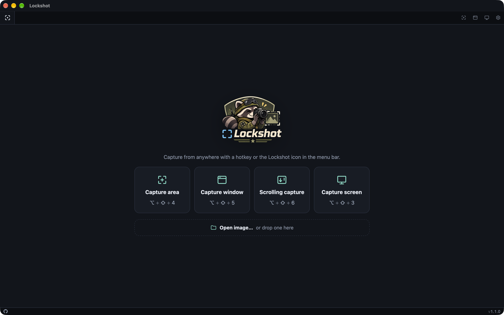
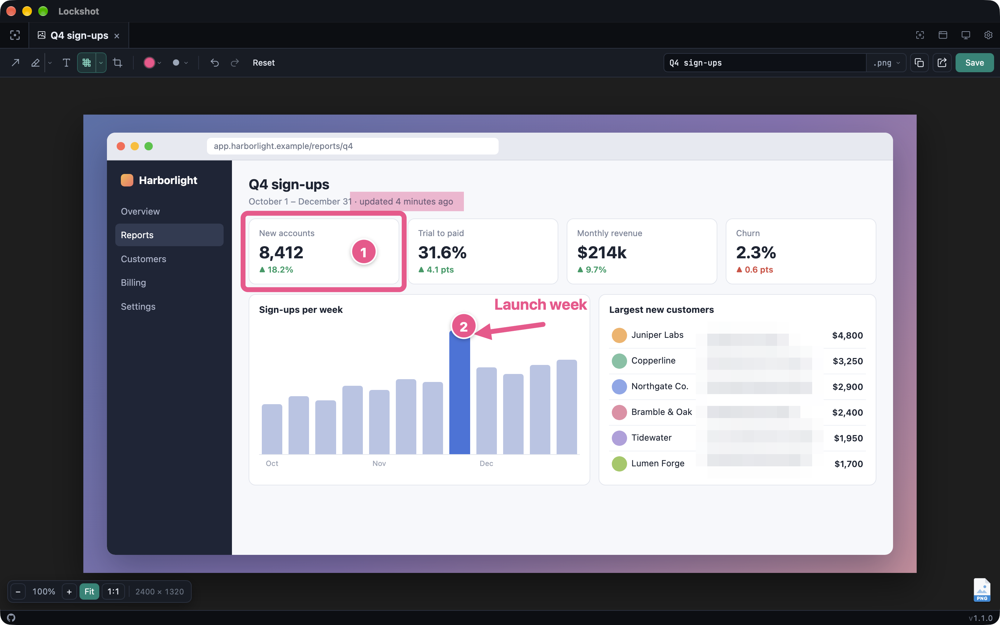
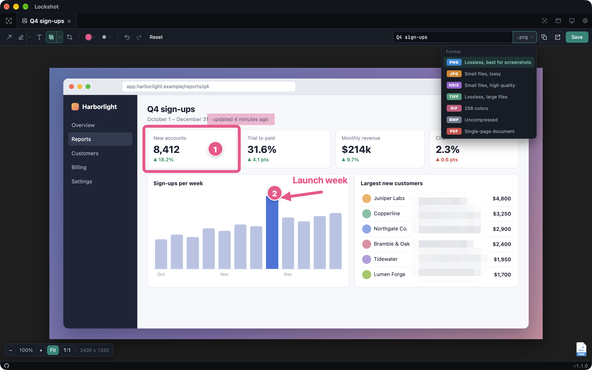
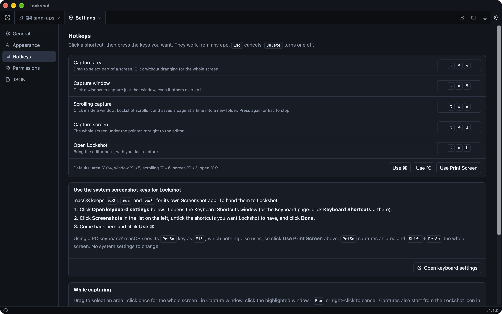
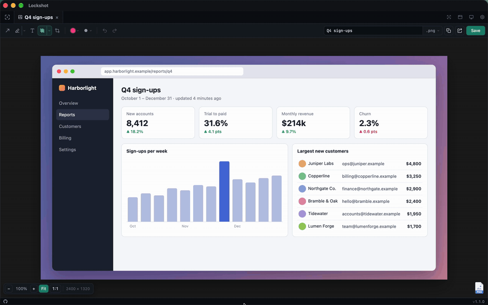

<p align="center">
  
</p>

<p align="center">
  A fast, open source screenshot and markup tool for macOS, Windows, and Linux.
</p>

<p align="center">
  <a href="https://github.com/fylzero/lockshot/releases/latest/download/Lockshot-macos-arm64.dmg"></a>
  <a href="https://github.com/fylzero/lockshot/releases/latest/download/Lockshot-windows-x64.exe"></a>
  <a href="https://github.com/fylzero/lockshot/releases/latest/download/Lockshot-linux-x64.AppImage"></a>
</p>

<p align="center">
  Also available:
  <a href="https://github.com/fylzero/lockshot/releases/latest/download/Lockshot-windows-arm64.exe">Windows ARM64</a> ·
  Linux <a href="https://github.com/fylzero/lockshot/releases/latest/download/Lockshot-linux-x64.deb">.deb</a>,
  <a href="https://github.com/fylzero/lockshot/releases/latest/download/Lockshot-linux-x64.rpm">.rpm</a> ·
  Linux ARM64 <a href="https://github.com/fylzero/lockshot/releases/latest/download/Lockshot-linux-arm64.AppImage">AppImage</a>,
  <a href="https://github.com/fylzero/lockshot/releases/latest/download/Lockshot-linux-arm64.deb">.deb</a>,
  <a href="https://github.com/fylzero/lockshot/releases/latest/download/Lockshot-linux-arm64.rpm">.rpm</a>
</p>

<p align="center">
  <a href="https://buymeacoffee.com/fylzero"></a>
</p>

## What is Lockshot?

Lockshot is an open source screenshot tool built with Tauri, Vue, and Rust. It lives in the menu bar (the system tray on Windows and Linux): press a hotkey, drag over what you want, mark it up, and save it in the format you need.

It's a sibling of [Shipyard](https://github.com/fylzero/shipyard) and [Recon](https://github.com/fylzero/recon), and shares their look and stack.

## Features

- **Menu bar / tray app**: Capture Area, Capture Window, Scrolling Capture, Capture Screen, Hotkeys, Settings and Check for Updates are one click away. Closing the window keeps Lockshot running.
- **Area capture**: Every display is frozen first, then you drag a selection over the frozen image, so menus and hover states stay put. Click without dragging for the whole screen. <kbd>Esc</kbd> or right-click cancels.
- **Capture Window**: Click a window to capture just that window, even if others overlap it.
- **Scrolling Capture**: Drag over the part of the screen to scroll (a chat thread, a web page) and Lockshot scrolls it a page at a time, saving that area into a new folder (`001.png`, `002.png`, …) until the content stops moving. Made for backing up long Slack, Discord or Teams threads, whose virtualized message lists never hold the whole conversation at once. Scroll down to the end, or up to the top for a thread's history (numbered top to bottom either way). The pages are also joined into one `Long image.png` with the overlap removed (split into parts past about 30,000 pixels); keep the pages, the long image, or both. On macOS, **Save the text** reads the messages into `Text.txt` with Apple's on-device text recognition. On macOS and Windows the mouse pointer is held still while it runs, so press <kbd>Esc</kbd> or the hotkey again to stop early; on Linux, press <kbd>Esc</kbd>, click Stop, or move the mouse. Set the direction, the wait after each scroll, the page limit and what to save in **Settings › General**. On macOS it needs Accessibility permission to scroll other apps' windows; it isn't available under Wayland.
- **Global hotkeys you can change**: Click a shortcut in Settings and press the new keys. Clashes with other Lockshot actions, or with combos another app owns, are caught and reported. A one-click preset takes over the system screenshot keys, with step-by-step instructions for freeing them on each OS.
- **Guided permissions**: On macOS, Lockshot checks Screen Recording access before every capture. If it's missing, Lockshot opens the right System Settings pane and walks you through allowing it and relaunching.
- **Home and Editor tabs**: Home walks you through setup one step at a time, then shows the capture buttons. Each capture or opened image gets its own Editor tab that keeps its annotations while you switch tabs; ⌘W / Ctrl+W closes tabs back to Home. Open images from Home, or drop a PNG, JPG, GIF, BMP, TIFF or HEIC file on the window.
- **Annotation editor**: Arrow, line, rectangle, ellipse, pen, highlighter, text, numbered steps (drag from one to point it at what it marks), pixelate (for redaction), and crop, with select-and-move, restyling, undo/redo, zoom, and a keyboard shortcut for every tool.
- **Save Without Editing**: Tick it in the menu bar / tray menu (or Settings) and every capture is saved straight to a file in the default format, skipping the editor. A small notice in the corner shows the file, with Edit to open that capture for markup after all. It can use its own folder, so you can grab a batch of shots into one place.
- **Export bar**: An editable file name and format picker, with Copy, Save As…, and Save beside them. A file icon at the right end shows the format; drag it out of the window to drop the image as a file, with its name and format, onto the Desktop, a folder, a browser upload, a chat, or any other app that takes files.
- **Formats**: PNG (the default, lossless), JPG, HEIC, TIFF, GIF, BMP, and PDF.
- **File names**: Defaults to `Screenshot-{date}-{time}`, for example `Screenshot-2026-11-19-20.41.07`. The template is editable and supports `{year}`, `{month}`, `{day}`, `{hour}`, `{minute}`, `{second}`, `{width}`, and `{height}`. Existing files are never overwritten.
- **Automatic updates**: Lockshot checks GitHub for new releases and installs them in place.

### Default hotkeys

| Action | macOS | Windows / Linux |
| --- | --- | --- |
| Capture area | ⌥⇧4 | Alt+Shift+4 |
| Capture window | ⌥⇧5 | Alt+Shift+5 |
| Scrolling capture | ⌥⇧6 | Alt+Shift+6 |
| Capture screen | ⌥⇧3 | Alt+Shift+3 |
| Open Lockshot | ⌥⇧L | Alt+Shift+L |

These use the same digits as the macOS screenshot keys without fighting the system for them. To use ⌘⇧4 / ⌘⇧3 (macOS) or PrtSc (Windows, Linux) instead, open **Settings › Hotkeys** and follow the instructions there.

## Screenshots

### Home

<p align="center">
  
</p>

Start any capture with one click, see its hotkey at a glance, or open an image to mark up.

### Annotation Editor

<p align="center">
  
</p>

Point things out with arrows, boxes, numbered steps, text and the highlighter, and pixelate anything private before you share it.

### Export

<p align="center">
  
</p>

Name the file, pick a format, then copy, save, or drag the file icon straight into another app.

### Hotkeys

<p align="center">
  
</p>

Change any global hotkey, or hand Lockshot the system screenshot keys with step-by-step instructions.

### Demo

<p align="center">
  
</p>

## Download & Installation

### macOS (Apple Silicon)

**[⬇️ Download Lockshot for macOS (Apple Silicon)](https://github.com/fylzero/lockshot/releases/latest/download/Lockshot-macos-arm64.dmg)**

Or install it with [Homebrew](https://brew.sh):

```sh
brew install fylzero/tap/lockshot
```

Lockshot updates itself, so Homebrew leaves upgrades to it. If Lockshot is already in Applications, add `--force` so Homebrew takes it over.

Current macOS builds are **Apple Silicon only**. Releases are signed with a Developer ID certificate and notarized by Apple.

On first launch, Lockshot asks for **Screen Recording** permission (*System Settings › Privacy & Security › Screen & System Audio Recording*). macOS applies it after a relaunch, which Lockshot offers to do for you. Because releases are signed with the same identity, the permission carries over to future updates. Scrolling Capture also asks for **Accessibility** (*Privacy & Security › Accessibility*) the first time you use it, so it can scroll the area you select. HEIC export uses the system encoder.

### Windows (x64 and ARM64)

**[⬇️ Download Lockshot for Windows (x64)](https://github.com/fylzero/lockshot/releases/latest/download/Lockshot-windows-x64.exe)**

Run the installer. It installs Lockshot for your user account without asking for administrator rights, and **Check for Updates…** in the tray menu keeps it current. On ARM PCs, like Snapdragon laptops, use [Lockshot-windows-arm64.exe](https://github.com/fylzero/lockshot/releases/latest/download/Lockshot-windows-arm64.exe) instead.

The installer isn't code-signed yet, so Windows SmartScreen may say **Windows protected your PC**. Click **More info**, then **Run anyway**.

Windows needs no capture permission. Windows 11 sends PrtSc to the Snipping Tool until you turn off *Settings › Accessibility › Keyboard › Use the Print screen key to open screen capture*. HEIC export isn't available on Windows.

### Linux (x64 and ARM64)

**[⬇️ Download Lockshot for Linux (AppImage, x64)](https://github.com/fylzero/lockshot/releases/latest/download/Lockshot-linux-x64.AppImage)**

Pick one package. Each one updates itself from **Check for Updates…** in the tray menu; the `.deb` and `.rpm` ask for your password to install the update.

| Package | Install |
| --- | --- |
| [AppImage](https://github.com/fylzero/lockshot/releases/latest/download/Lockshot-linux-x64.AppImage) (any distro) | `chmod +x Lockshot-linux-x64.AppImage`, then run it |
| [.deb](https://github.com/fylzero/lockshot/releases/latest/download/Lockshot-linux-x64.deb) (Debian, Ubuntu, Mint) | `sudo apt install ./Lockshot-linux-x64.deb` |
| [.rpm](https://github.com/fylzero/lockshot/releases/latest/download/Lockshot-linux-x64.rpm) (Fedora, RHEL, openSUSE) | `sudo dnf install ./Lockshot-linux-x64.rpm` |

Use the `arm64` files on ARM machines. Lockshot needs Ubuntu 24.04, Debian 13, Fedora 40, or a newer distro. The tray icon needs an AppIndicator host; GNOME requires the AppIndicator extension. HEIC export needs libheif's `heif-enc`.

Under Wayland, apps can't grab global hotkeys, so bind these commands in your desktop's keyboard settings instead (with the AppImage, run the AppImage with the same flag):

```bash
lockshot --area
```

```bash
lockshot --screen
```

A second launch passes the flag to the running copy, so these also work on macOS and Windows.

## Development

Lockshot is built with [Tauri](https://v2.tauri.app/): a Vue.js frontend with a Rust native backend. To build and run from source, you'll need **Bun**, **Rust**, and a C toolchain: **Xcode Command Line Tools** on macOS, the **Visual Studio Build Tools** on Windows, or the **WebKitGTK** and screen capture development packages on Linux.

### Prerequisites

#### 1. Clone the repository

```bash
git clone https://github.com/fylzero/lockshot.git
cd lockshot
```

#### 2. Native build tools

**macOS:** Xcode Command Line Tools provide the C/C++ compiler that Rust uses.

```bash
xcode-select --install
```

**Linux:** install a compiler, WebKitGTK, the tray library, and the PipeWire, XCB and GBM headers screen capture uses. On Debian or Ubuntu:

```bash
sudo apt install build-essential curl pkg-config libwebkit2gtk-4.1-dev libxdo-dev libssl-dev librsvg2-dev libayatana-appindicator3-dev libpipewire-0.3-dev libclang-dev libxcb1-dev libxcb-randr0-dev libdbus-1-dev libgbm-dev libegl-dev
```

For Fedora, Arch, and other distros, see [Tauri's Linux prerequisites](https://v2.tauri.app/start/prerequisites/#linux) and add the matching PipeWire, XCB, GBM and Clang development packages.

**Windows:** install the [Build Tools for Visual Studio](https://visualstudio.microsoft.com/visual-cpp-build-tools/) with the **Desktop development with C++** workload. See [Tauri's Windows prerequisites](https://v2.tauri.app/start/prerequisites/#windows) for details. WebView2 already comes with Windows 10 and 11.

#### 3. Bun

Install using the official script from [bun.sh](https://bun.sh/):

```bash
curl -fsSL https://bun.sh/install | bash
```

On Windows, run `powershell -c "irm bun.sh/install.ps1 | iex"` instead.

#### 4. Rust

Install the official toolchain with [rustup](https://www.rust-lang.org/tools/install):

```bash
curl --proto '=https' --tlsv1.2 -sSf https://sh.rustup.rs | sh
```

On Windows, download and run `rustup-init.exe` from the same page and keep the default MSVC toolchain. Then **open a new terminal**. `bun run tauri dev` already prepends `$HOME/.cargo/bin` to `PATH`.

### Running in development

```bash
bun install
```

```bash
bun run tauri dev
```

On Windows, run `bunx tauri dev` instead. The `tauri` script sets `PATH` the Unix way, which doesn't work there.

This starts Vite on `http://localhost:1440`, compiles the Rust backend, and opens Lockshot with hot reload. On first launch the window opens on Home; after that Lockshot starts in the menu bar.

`bun run dev` on its own serves the UI at `http://localhost:1440` with a mocked backend and a sample capture, which is handy for working on the editor in a browser.

#### Testing screen capture on macOS

`bun run tauri dev` runs a bare executable, so macOS gives Screen Recording permission to the terminal that launched it, not to Lockshot. Either:

- Add your terminal app under *System Settings › Privacy & Security › Screen & System Audio Recording* and restart it. Captures then work in `bun run tauri dev`.
- Or build, sign with your Developer ID, and install the real app to `/Applications`. macOS remembers the permission by signer, so it survives rebuilds:

  ```bash
  bun run install:mac
  ```

  Add `-- --debug` for a faster debug build. It picks up the Developer ID certificate from your keychain and skips notarization, which only downloads need.

### Building a release

```bash
bun run tauri build
```

On macOS this produces `src-tauri/target/release/bundle/macos/Lockshot.app` and a DMG under `bundle/dmg`. Local builds are ad-hoc signed unless an Apple identity is supplied, so Gatekeeper may warn that the app is unidentified, and macOS asks for Screen Recording permission again after every local rebuild. On Linux it produces an AppImage, `.deb` and `.rpm`; on Windows (`bunx tauri build`), an NSIS installer and an MSI.

### Running checks

```bash
bun run build
```

```bash
cd src-tauri && cargo fmt --check && cargo clippy --all-targets -- -D warnings && cargo test
```

### Icons

The app icon comes from `app-icon.png` in the repo root (1024×1024 recommended). The tray icons come from `scripts/icons/*.svg`. After changing either, regenerate everything:

```bash
bun run icons
```

`scripts/icons/cutout.py` is how the current `app-icon.png` was made from the logo on its navy background. It removes a flat background with a smooth, anti-aliased edge and fits the art onto a transparent 1024×1024 square. It needs Pillow, NumPy and SciPy:

```bash
python3 scripts/icons/cutout.py logo-on-navy.png app-icon.png 1024 14 1.0
```

## Publishing signed releases

Pushing a `v*` tag runs the Release workflow. It builds, signs and notarizes the macOS app first, then builds the Linux x64 and ARM64 packages, then the Windows x64 and ARM64 installers, and adds them all to the same GitHub release with the `latest.json` the in-app updater reads.

See [macOS release setup](docs/macos-releases.md) for Apple Developer enrollment, repository secrets, and the code signing and notarization process, [Linux releases](docs/linux-releases.md) for the Linux packages and how they update, and [Windows releases](docs/windows-releases.md) for the Windows installers and code signing.

## Contributing

See [CONTRIBUTING.md](CONTRIBUTING.md) for code style, required checks, and how to submit issues and pull requests.

## Support

If Lockshot saves you time, you can [buy me a coffee](https://buymeacoffee.com/fylzero) or [sponsor on GitHub](https://github.com/sponsors/fylzero).

## License

MIT License - see [LICENSE](LICENSE) for details.

Copyright (c) 2026 RazorKode LLC
